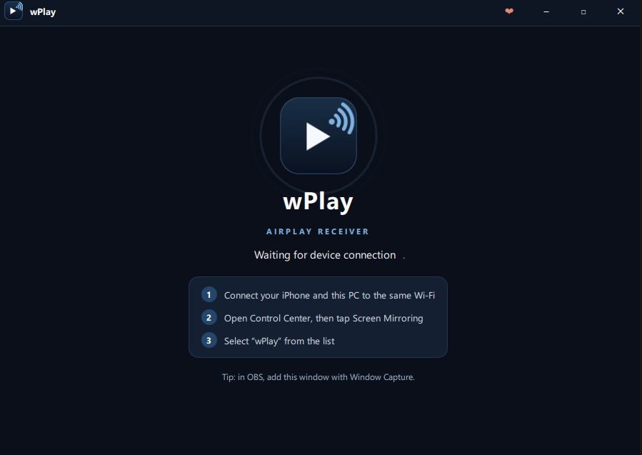
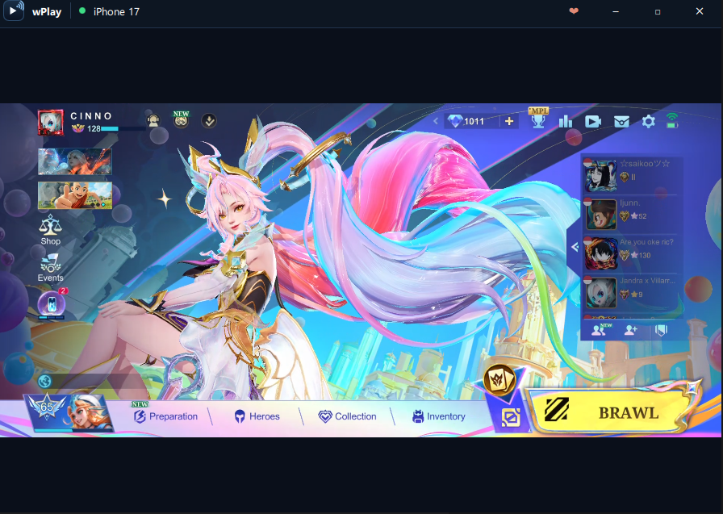

# wPlay

**Receiver AirPlay mandiri untuk Windows — mirror layar iPhone ke PC, siap ditangkap OBS untuk live streaming.**

## Tampilan

*Layar tunggu wPlay — animasi sonar di sekitar logo sambil menunggu koneksi dari iPhone.*

*Mirror layar iPhone yang sedang berjalan di jendela wPlay, siap ditangkap OBS.*

## Apa ini?

wPlay adalah aplikasi Windows kecil dan ringan yang tugasnya satu:
menerima mirror layar iPhone lewat AirPlay. Buat streamer iPhone yang
mau live dari PC — misalnya main Mobile Legends di HP, tampilannya
masuk ke PC, lalu ditangkap OBS atau TikTok LIVE Studio untuk
disiarkan. Tidak ada fitur manajemen iPhone, tidak ada bloat — buka,
mirror, selesai.

Nama server AirPlay yang muncul di iPhone: **wPlay**.

## Fitur

- **Receiver AirPlay mandiri & ringan** — fokus menerima mirror saja,
  tanpa fitur manajemen iPhone.
- **Nama server "wPlay"** — mudah dikenali di daftar Screen Mirroring
  iPhone.
- **Layar tunggu beranimasi** — cincin sonar, logo bernapas, dan
  indikator tunggu yang halus.
- **Dukungan donasi di dalam aplikasi** — pop-up dukungan satu kali
  saat pertama dibuka, plus tombol dukungan permanen.
- **Installer Windows siap pakai** — pasang seperti aplikasi biasa,
  lengkap dengan pintasan dan uninstaller.
- **Gratis & open source** — kode sumber terbuka di bawah lisensi
  AGPL-3.0.

## Unduh

Unduh installer versi terbaru dari halaman
[**Releases**](https://github.com/elyos141299/wplay/releases) repo ini
(`wPlay-Setup.exe`), lalu jalankan seperti memasang aplikasi Windows
biasa. Bila Windows menampilkan SmartScreen, pilih **More info → Run
anyway** (aplikasi ini belum memiliki tanda tangan digital).

**Kebijakan tanda tangan kode:** wPlay sedang mengajukan tanda tangan
kode gratis untuk proyek open source dari **SignPath Foundation**.
Bila disetujui, penandatanganan akan dilakukan oleh SignPath
Foundation atas nama proyek ini, terhadap file yang dibangun
otomatis dari kode sumber publik di repo ini. Selama proses itu
berjalan, installer masih belum bertanda tangan, jadi SmartScreen
di atas masih bisa muncul.

## Cara pakai

1. Pasang wPlay dari installer, lalu buka aplikasinya.
2. Pastikan iPhone dan PC terhubung ke **jaringan WiFi yang sama**.
3. Di iPhone, buka **Pusat Kontrol → Screen Mirroring**.
4. Pilih **"wPlay"** dari daftar — layar iPhone tampil di jendela wPlay.
5. Di OBS, tambahkan sumber **Window Capture** dan pilih jendela wPlay.

## Persyaratan

- Windows 10/11 **64-bit**.
- iPhone dan PC berada di **satu jaringan WiFi yang sama**.
- Layanan **Bonjour** terpasang di PC (biasanya ikut terpasang bersama
  iTunes, atau lewat Bonjour Print Services dari Apple). Catatan jujur:
  tanpa Bonjour, iPhone tidak akan menemukan wPlay di daftar Screen
  Mirroring — installer wPlay saat ini belum menanam Bonjour, jadi
  pastikan layanan ini sudah ada di PC kamu.

Kualitas mirror mengikuti jaringanmu: WiFi 5 GHz dan PC yang terhubung
kabel LAN memberi hasil paling mulus.

## Dukung pengembangan

wPlay gratis dan akan tetap gratis. Kalau aplikasi ini membantu
stream kamu, kamu bisa ikut mendukung pengembangannya lewat donasi
sukarela di SociaBuzz:

☕ **[sociabuzz.com/oroboo/tribe](https://sociabuzz.com/oroboo/tribe)**

## Kredit & asal-usul

wPlay tidak ditulis dari nol — ia adalah turunan open-source, dan
semua kredit milik penulis aslinya:

- **iDescriptor v0.6.1** ([github.com/iDescriptor/iDescriptor](https://github.com/iDescriptor/iDescriptor),
  tag `v0.6.1`, commit `f4d1c1bccf7c4b45244023a4d293018b19dd768c`) —
  wPlay dibuat dari bagian AirPlay milik iDescriptor, karya
  [Uncore](https://github.com/uncor3) dan para kontributor iDescriptor.
- **UxPlay** (commit terkunci `eaca2458946d8a283df3b872f25c6b7cc98be411`,
  submodule `lib/uxplay` di iDescriptor v0.6.1) — receiver AirPlay
  yang sebenarnya bekerja di balik layar; ditempel ke aplikasi lewat
  jembatan tipis `src/airplay.rs`. UxPlay di iDescriptor adalah fork
  dari [UxPlay upstream](https://github.com/FDH2/UxPlay).

Pendekatan ini disebut **Jalur A** — memakai UxPlay dari v0.6.1 karena
sudah terbukti berjalan. Library alternatif `rsplay` (Jalur B) tidak
dipakai. Atribusi lengkap per file ada di
[`licenses/NOTICE.md`](licenses/NOTICE.md).

## Lisensi

- wPlay: **AGPL-3.0-or-later**
- iDescriptor: **AGPL-3.0-or-later**
- UxPlay: **GPL-3.0**

Karena memakai kode-kode di atas, wPlay wajib tetap open-source
dengan lisensi yang kompatibel bila dibagikan ke orang lain, lengkap
dengan kredit ke penulis asli. Teks lisensi lengkap ada di file
[`LICENSE`](LICENSE) dan folder [`licenses/`](licenses/)
(`AGPL-3.0.txt`, `GPL-3.0.txt`).
